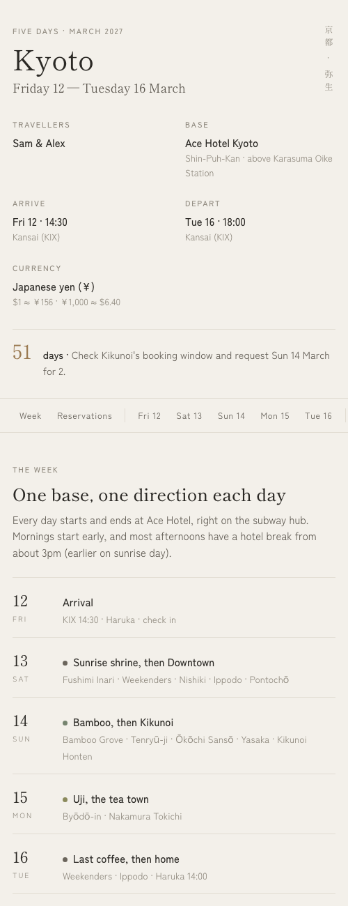
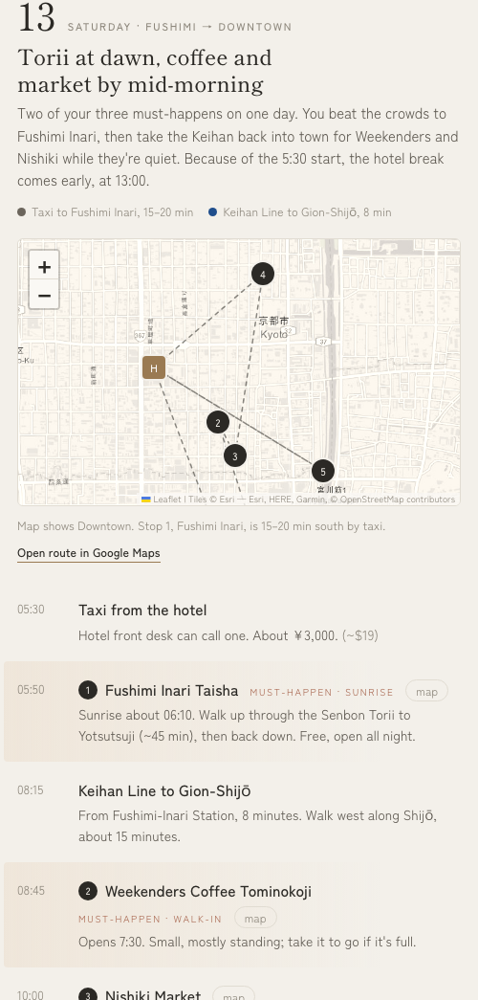

# trip-itinerary-site

An agent skill that turns a trip plan into a calm, phone-friendly itinerary website: one HTML file you can share with whoever you're travelling with.

<p>
  
  
</p>

Give your agent whatever you have: a spreadsheet planner, a PDF, booking emails, or a list of restaurants. It asks you a few questions, checks the facts, and builds a page with:

- **A map for each day** with numbered stops, in the same order and with the same numbers as the timeline, plus a link that opens the route in Google Maps.
- **Places grouped by neighbourhood**, with travel time from your hotel, so you can see what's near what.
- **A reservations section** with your priority bookings first, the date each one opens, a countdown to the next one, and tick boxes.
- **Local prices with your home currency** next to every one, at a dated exchange rate.
- **A Japandi design** (linen, charcoal, hairline rules) that follows your phone's light or dark mode.

## How it behaves

- **It asks before it plans.** Your hotel, your list of places, which ones are must-happens, and what's already booked. It never picks your priorities or adds places you didn't ask for, unless you ask it to suggest some.
- **It checks facts.** Opening hours on your actual days, closed days, branches that have shut, how and when bookings open. It flags anything that clashes with your plan, such as a ticket booked for a day the museum is closed, rather than quietly changing it.
- **It keeps private details off the page.** Confirmation codes, e-ticket numbers, card details and personal emails are left out, because these pages often end up on a public link.
- **It asks where to publish:** a local file, [Surge](https://surge.sh), or whatever hosting your agent can use.

## Install

The skill is a folder with a `SKILL.md`, following the [Agent Skills](https://agentskills.io) format. Copy the **whole folder**, not just `SKILL.md`, because the scripts and template do the building.

**Claude Code**
```bash
git clone https://github.com/pinnyeow/trip-itinerary-site ~/.claude/skills/trip-itinerary-site
```

**Hermes Agent**
```bash
git clone https://github.com/pinnyeow/trip-itinerary-site ~/.hermes/skills/trip-itinerary-site
```

**Other agents:** put the folder wherever your agent loads skills from.

Then ask something like *"make our Lisbon trip into a website, here's our plan..."*.

## Requirements

| What | Needed for | Notes |
|---|---|---|
| Python 3.8+ | building the page | Standard library only |
| Web search | checking hours, bookings, exchange rate | Most agents have it |
| Internet | map lookups, and map tiles when viewing the page | |
| Chrome, Chromium, Edge or Playwright | optional visual check | `scripts/screenshot.py` finds it; Pillow makes viewable slices |
| `surge` CLI, logged in | optional publishing | Any static host works |

## Try it without an agent

```bash
python3 scripts/build.py assets/example-trip.json out/index.html
open out/index.html   # or xdg-open on Linux
```

`assets/example-trip.json` is a fictional couple's five days in Kyoto. `references/trip-schema.md` documents every field.

## What's inside

```
SKILL.md                    instructions the agent follows
assets/template.html        the page: layout, styles, maps, booking ticks
assets/example-trip.json    a complete worked example
scripts/build.py            validates trip.json and renders the page
scripts/geocode.py          coordinates via OpenStreetMap Nominatim, falling back to Photon
scripts/screenshot.py       phone-width screenshot with whatever browser is installed
references/trip-schema.md   the trip.json format
evals/evals.json            test prompts used to develop the skill
```

## Notes

- **Ticks on the page save per device.** To show a booking as confirmed for everyone, tell your agent ("we booked X at 7pm for 2"). It adds the booking to the trip file and rebuilds.
- **Map pins can be approximate.** Small restaurants are often missing from OpenStreetMap, so those pins are estimated and marked as such. The Google Maps links search by name, so they still open the right place.
- **Map tiles** are from Esri's World Light and Dark Gray Canvas, map data © OpenStreetMap contributors. Maps are drawn with [Leaflet](https://leafletjs.com). Fonts are Shippori Mincho and Zen Kaku Gothic New from Google Fonts.
- **Always reconfirm hours and bookings** the week before you travel.

## License

MIT
